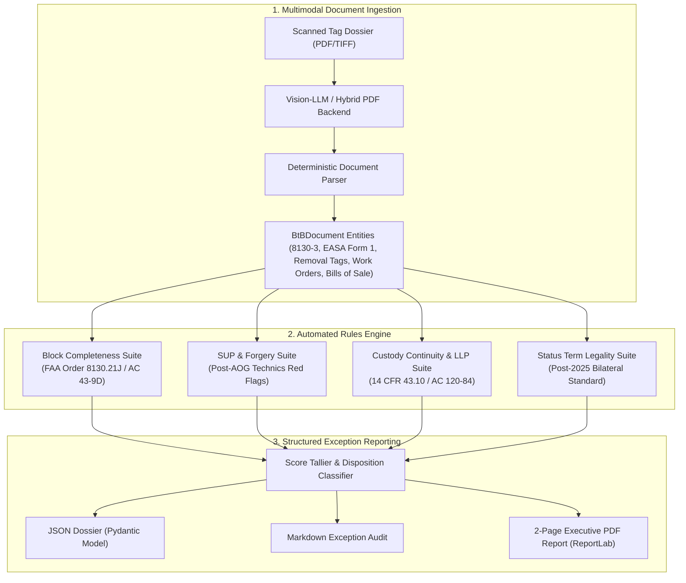

# USM Back-to-Birth Trace Exception-Audit Desk (`us-trace-desk`)

> **Autonomous AI Pre-Audit Pipeline for Aviation Used Serviceable Material (USM) Back-to-Birth Documentation**  
> *Ingests scanned FAA Form 8130-3, EASA Form 1, removal tags, logbooks, and work orders to generate structured 2-page Exception Reports before parts enter inventory.*

[](LICENSE)
[](pyproject.toml)
[-success.svg)](tests/)
[](https://www.faa.gov/)

---

## 1. Commercial & Market Thesis

### The Post-AOG Technics Crisis & Regulatory Pressure
In 2023–2024, the aviation industry was rocked by the **AOG Technics** scandal: thousands of unauthorized engine components with forged **FAA Form 8130-3** and **EASA Form 1** tags were distributed into global airline fleets, grounding over 120 commercial aircraft. Investigation revealed that the counterfeit documentation shared systematic flaws:
- **Omission of mandatory installer responsibility boilerplate** (FAA Order 8130.21J Appendix A).
- **Un-shaded opposing release blocks** (Block 13 or 14 left blank instead of grayed-out).
- **Colloquial nomenclature traps** where fraudsters substituted generic terms (e.g., `'bushing'`) for official OEM IPC catalog terminology (e.g., `'bushing shrd (IGV)'`).
- **Signatory certificate mismatches** between the issuing facility in Block 4 and the authorized certifier in Block 14c.

As a result, the FAA, EASA, and UK CAA issued urgent Suspected Unapproved Parts (SUP) alerts. Receiving inspection scrutiny at airlines, MROs, and leasing companies has intensified by an order of magnitude. A single documentation exception can strand a $50,000 rotables assembly or trigger mandatory quarantine.

### The Teardown Wave: 100+ A320neo Airframes Parting Out
Simultaneously, the commercial aviation supply chain is undergoing an unprecedented teardown cycle:
- **100+ Airbus A320neo and Boeing 737 MAX aircraft** are currently committed to early teardown and part-out (CNBC / Aviation Week, late 2026), driven by GTF and LEAP engine maintenance turnarounds.
- Lessors and teardown coordinators (e.g., ELFC, EirTrade) are dismantling airframes as young as 4 to 6 years old to supply high-demand USM components.
- The volume of rotable components entering aftermarket distribution has doubled, flooding independent aviation parts dealers with complex, multi-operator document dossiers.

### The Market Gap: Trace Deficiency & The Mid-Tier USM Dealer Void
- **Trace Stated on Only 44.3% of Quote Lines**: According to the **MG Aviation Quote Census (Jun–Sep 2026)** across 85M+ line items on ILSmart and PartsBase, complete Back-to-Birth (BtB) trace was certified on only 44.3% of quote lines.
- **2.5x Valuation Gap**: Parts with missing or unverified trace trade at an As-Removed (AR) median discount of **0.24x new price**, whereas parts with certified, pre-audited Back-to-Birth trace trade at **0.59x new price (Serviceable / Overhauled)**. Clearing documentation exceptions unlocks massive immediate gross margin.
- **Manual Bottleneck**: Receiving technicians at MROs spend 15 to 45 minutes manually cross-checking serial numbers, flight hours, and block certifications for every serialized rotable.
- **Enterprise Monopoly**: **ProvenAir** (founded 2020) charges enterprise SaaS retainers accessible only to top-tier airlines and major lessors (Delta, United, Lufthansa, AerCap). **doana.ca** sells raw box-by-box OCR extraction without compliance rules or exception analysis.
- **The Opportunity**: Over 1,200 mid-tier US independent aviation parts dealers, USM brokers, and teardown facilities have **zero automated tooling** to pre-audit document packages prior to taking inventory or dispatching quotes.

---

## 2. Technical Architecture & Rules Engine

`us-trace-desk` operates as an agentic pre-audit engine that ingests multi-page scanned PDF or image packages and executes an automated 4-tier regulatory audit.



### The 4 Core Compliance Suites

1. **FAA Form 8130-3 Block Completeness (FAA Order 8130.21J & AC 43-9D)**:
   - Validates all mandatory fields: Block 1 (Authority), Block 2 (Organization), Block 3 (Tracking No), Block 4 (Certificate No), Block 7 (Description), Block 8 (Part No), Block 10 (Qty), Block 11 (Status/Work), Block 12 (Remarks).
   - Validates release block segregation: Block 13a–e (Production) vs. Block 14a–e (Maintenance Return to Service).
   - **Label-based normalization**: Maps printed label variations across legacy revisions (Order 8130.21G, 8130.21H, 8130.21J).

2. **Suspected Unapproved Parts (SUP) & Forgery Detection (AOG Technics Case Precedent)**:
   - **Mandatory Installer Disclaimer**: Catches omission of required FAA Order 8130.21 boilerplate (*"It is important to understand that the existence of this document alone does not automatically constitute authority to install..."*).
   - **Shading Verification**: Verifies that Block 14 is shaded out for new part production, and Block 13 is shaded out for maintenance releases.
   - **OEM Nomenclature Mismatch**: Cross-references OEM Illustrated Parts Catalog (IPC) descriptions against generic counterfeit terms (e.g., catching generic `'bushing'` when the CFM56 IPC mandates `'BUSHING SHRD (IGV)'`).
   - **Signatory Certificate Divergence**: Validates that the releasing facility certificate in Block 4 strictly matches the signatory certificate in Block 14c.

3. **Chain-of-Custody Continuity & Life-Limited Parts (LLP) Tracking (14 CFR 43.10 / AC 120-84)**:
   - **Chronological Date Monotonicity**: Verifies that teardown dates, work order completions, and release tags follow a continuous chronological sequence without temporal regressions.
   - **Non-Decreasing Cycles & Hours**: Enforces mathematical monotonicity on Time Since New (TSN) and Cycles Since New (CSN); catches rollback fraud and discontinuous records.
   - **Mandatory Life Limit Enforcement**: Verifies that current CSN has not exceeded published manufacturer retirement limits.
   - **Identity Reconciliation**: Ensures part number and serial number continuity across all removal tags, logbook entries, repair orders, and bills of sale.
   - **Chain of Title Integrity**: Flags missing bills of sale, untraced intermediary brokers, or omitted Non-Incident Statements (NIS).

4. **Block 11 Status/Work Term Legality (Post-2025 FAA/EASA Split)**:
   - Enforces post-2025 restricted airworthiness terminology:
     - **Authorized Maintenance**: `OVERHAULED`, `REPAIRED`, `INSPECTED`, `TESTED`, `MODIFIED`.
     - **Authorized Production**: `NEW`, `PROTOTYPE`.
   - **Strictly Prohibits**: `SERVICEABLE` (illegal in Block 11 per Order 8130.21J), `AS REMOVED`, `AR`, `REBUILT` (illegal for repair stations under 14 CFR 43.3), `CHECKED`, and noun variants (`OVERHAUL`, `REPAIR`).

---

## 3. Installation & Usage

### Setup
```bash
git clone https://github.com/managerytacc81-png/us-trace-desk.git
cd us-trace-desk
pip install -e .
```

### CLI Commands

#### 1. Run Autonomous Demonstration
Executes synthetic audits of clean compliant packages and AOG Technics forged packages:
```bash
trace-desk demo --out data/demo_reports
```

#### 2. Audit a Package or Document Directory
```bash
trace-desk audit path/to/trace_dossier.json --out data/reports
```

#### 3. Run Test Suite
```bash
pytest -v
```

---

## 4. Sample Exception Report Output

Each audit produces a structured 2-page docket:
- **Disposition Status**:
  - `🟢 PASS`: Full airworthiness compliance; score >= 85.
  - `🟡 CONDITIONAL PASS`: Clerical discrepancy remediable via vendor affidavit.
  - `🔴 REJECT - SUP ALERT`: Critical forgery red flag or discontinuous custody; mandatory quarantine.
- **Discrepancy Matrix**: Tabulated findings with regulatory citations and actionable dealer remediation steps.
- **Flight Accumulation & Custody Timeline**: Chronological log of hours, cycles, and operator handoffs.
- **Quality Manager Sign-Off**: Verification block for dealer ASA-100 receiving inspection files.

---

## 5. Commercial Packaging & Pricing

| Service Tier | Turnaround | Price | Scope |
| :--- | :--- | :--- | :--- |
| **Initial Trial Audit** | 48 Hours | **FREE** | 1 Complete BtB Package (2-Page Exception Report) |
| **Per-Package Audit** | 24 Hours | **$150 – $250 / pkg** | Individual serialized rotable / engine LLP audit |
| **Dealer Retainer** | Same-Day Priority | **$1,500 – $3,000 / mo** | 15–30 packages/mo + receiving desk integration |

---

## 6. Regulatory Standards Reference

- **FAA Order 8130.21J**: *Procedures for Completion and Use of the Authorized Release Document, FAA Form 8130-3*
- **FAA Advisory Circular AC 43-9D**: *Maintenance Records*
- **FAA Advisory Circular AC 120-84**: *FAA Aircraft Component Traceability*
- **14 CFR § 43.9 & § 43.10**: *Content, Form, and Disposition of Life-Limited Part Records*
- **FAA Unapproved Parts Notice (AOG Technics Precedent)**: *Advisory on Counterfeit CFM56 Documentation*
- **ASA-100 Standard**: *Aviation Suppliers Association Quality System Standard*

---
*Developed by Robert Ketler | Autonomous Aviation Systems Desk*  
*Email: managerytacc81@gmail.com | Phone: 330-696-9076*
